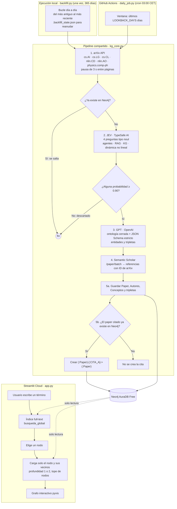

# arXiv Knowledge Graph

Grafo de conocimiento automático sobre papers de arXiv (agentes de IA, RAG, grafos de
conocimiento y dinámica no lineal), con citas cruzadas y un explorador web público.

```
arXiv → JEV (cribado ≥ 90 %) → GPT (tripletas JSON) → Semantic Scholar (citas) → Neo4j AuraDB → Streamlit
```

| Fichero | Qué hace |
|---|---|
| `kg_core.py` | Lógica compartida: una clase por etapa del pipeline |
| `backfill.py` | Carga histórica de 1 año, en local, reanudable |
| `daily_job.py` | Actualización diaria (la lanza GitHub Actions) |
| `app.py` | Explorador web en Streamlit (búsqueda + vecindario) |
| `.github/workflows/daily_job.yml` | Cronjob diario a las 03:00 CET |
| `requirements.txt` | Dependencias exactas |
| `.env.example`, `.streamlit/secrets.toml.example` | Plantillas de credenciales |

---

## 1. Manual de instrucciones y configuración

### 1.1 Cuentas que hay que crear

| Servicio | Dónde | Qué obtienes | Coste |
|---|---|---|---|
| **Neo4j AuraDB** | https://console.neo4j.io → *New instance* → **AuraDB Free** | Al crearla se descarga un `.txt` con `NEO4J_URI`, `NEO4J_USERNAME` y `NEO4J_PASSWORD`. **La contraseña solo se muestra una vez.** | Gratis (máx. 200 000 nodos / 400 000 relaciones; se pausa tras 3 días sin uso) |
| **JEV (TypeSafe AI)** | https://typesafe.ai → crear cuenta → *API keys* (o vía AIML API: https://aimlapi.com → *Key management*) | `JEV_API_KEY` | Muy barato (pago por tokens de entrada) |
| **OpenAI Platform** | https://platform.openai.com → *Settings → Billing* (añade saldo prepago, mínimo 5 $) → *API keys → Create new secret key*. **Es una cuenta distinta de ChatGPT Plus: la suscripción no incluye API.** | `OPENAI_API_KEY` | Pago por uso (`gpt-6-luna`: 0,10 $ / 0,50 $ por millón de tokens de entrada / salida) |
| **Semantic Scholar** | https://www.semanticscholar.org/product/api → *Request an API key* (formulario, tarda unos días) | `SEMANTIC_SCHOLAR_API_KEY` | Gratis. Funciona sin clave, pero mucho más lento |
| **GitHub** | https://github.com → *New repository* (público si quieres que sea open source) | Repositorio donde vive el código y corre el cronjob | Gratis |
| **Streamlit Community Cloud** | https://share.streamlit.io → *Continue with GitHub* | La web pública | Gratis |

### 1.2 Dónde pegar cada secreto

**GitHub** → tu repositorio → *Settings* → *Secrets and variables* → *Actions*

Pestaña **Secrets** → *New repository secret* (uno por fila):

| Nombre | Valor |
|---|---|
| `NEO4J_URI` | `neo4j+s://xxxx.databases.neo4j.io` (del `.txt` de Aura) |
| `NEO4J_USERNAME` | `neo4j` |
| `NEO4J_PASSWORD` | contraseña del `.txt` de Aura |
| `NEO4J_DATABASE` | `neo4j` |
| `JEV_API_KEY` | clave de JEV |
| `JEV_API_URL` | *(opcional)* solo si usas AIML API: `https://api.aimlapi.com/v1/decisions` |
| `JEV_MODEL` | *(opcional)* solo si usas AIML API: `typesafe/jev` |
| `OPENAI_API_KEY` | clave de OpenAI (`sk-...`) |
| `SEMANTIC_SCHOLAR_API_KEY` | clave de Semantic Scholar (si la tienes) |

Pestaña **Variables** → *New repository variable* (opcionales, no son secretas):

| Nombre | Valor por defecto |
|---|---|
| `LLM_MODEL` | `gpt-6-luna` |
| `LLM_REASONING_EFFORT` | `low` (vacío si el modelo no razona) |
| `JEV_THRESHOLD` | `0.90` |
| `LOOKBACK_DAYS` | `3` |

**Streamlit Cloud** → tu app → *⋮* → *Settings* → *Secrets*. Pega (formato TOML):

```toml
NEO4J_URI = "neo4j+s://xxxx.databases.neo4j.io"
NEO4J_USERNAME = "neo4j"
NEO4J_PASSWORD = "tu-contraseña"
NEO4J_DATABASE = "neo4j"
```

La app solo necesita Neo4j: **no pongas en Streamlit las claves de JEV ni de OpenAI.**

**En local** copia `.env.example` como `.env` y rellénalo (lo usan `backfill.py` y `daily_job.py`).

### 1.3 Variables de entorno que usan los scripts

| Variable | Obligatoria | Usada por | Descripción |
|---|---|---|---|
| `NEO4J_URI` | Sí | todos | URI de AuraDB (`neo4j+s://...`) |
| `NEO4J_USERNAME` | No (`neo4j`) | todos | Usuario |
| `NEO4J_PASSWORD` | Sí | todos | Contraseña |
| `NEO4J_DATABASE` | No (`neo4j`) | todos | Base de datos |
| `JEV_API_KEY` | Sí | backfill, daily | Clave de JEV |
| `JEV_API_URL` | No (`https://api.typesafe.ai/v1/systemone`) | backfill, daily | Endpoint de JEV |
| `JEV_MODEL` | No | backfill, daily | `typesafe/jev` si se usa AIML API |
| `JEV_THRESHOLD` | No (`0.90`) | backfill, daily | Probabilidad mínima para aprobar |
| `OPENAI_API_KEY` | Sí | backfill, daily | Clave de OpenAI |
| `LLM_MODEL` | No (`gpt-6-luna`) | backfill, daily | Modelo de GPT para la extracción |
| `LLM_REASONING_EFFORT` | No (`low`) | backfill, daily | Esfuerzo de razonamiento; vacío para modelos sin razonamiento |
| `SEMANTIC_SCHOLAR_API_KEY` | No | backfill, daily | Clave de Semantic Scholar |
| `LOOKBACK_DAYS` | No (`3`) | daily | Días hacia atrás que revisa el job diario |
| `JEV_WORKERS` / `LLM_WORKERS` | No (`8` / `4`) | backfill, daily | Peticiones en paralelo |
| `LOG_LEVEL` | No (`INFO`) | backfill, daily | Nivel de detalle del log |

### 1.4 Puesta en marcha paso a paso

```bash
# 1. Entorno local
python -m venv .venv
.venv\Scripts\activate          # Windows  (Linux/Mac: source .venv/bin/activate)
pip install -r requirements.txt
copy .env.example .env          # y rellénalo

# 2. Prueba corta (2 días) antes del año completo
python backfill.py --days 2

# 3. Histórico completo (horas; se puede cortar y reanudar)
python backfill.py

# 4. App en local
copy .streamlit\secrets.toml.example .streamlit\secrets.toml   # y rellénalo
streamlit run app.py
```

5. Sube la carpeta a GitHub (`git init`, `git add .`, `git commit`, `git push`) — `.env` y `secrets.toml` están en `.gitignore`.
6. Añade los Secrets de GitHub (1.2). Pruébalo en *Actions → Daily arXiv Knowledge Graph update → Run workflow*.
7. En https://share.streamlit.io → *Create app* → elige el repositorio, rama `main`, fichero `app.py` → *Advanced settings* → pega los Secrets → *Deploy*.

### 1.5 Avisos importantes

- **Límite de AuraDB Free (200 k nodos / 400 k relaciones).** `cs.LG` + `cs.AI` + `cs.CL` suman muchos miles de papers al año. JEV filtra la mayoría, pero vigila el uso en la consola de Aura y, si te acercas al límite, sube `JEV_THRESHOLD` o reduce `--days`.
- **AuraDB Free se pausa tras 3 días sin actividad.** El job diario la mantiene activa; si se pausa, reactívala desde la consola.
- **GitHub desactiva los cron** de repos sin actividad durante 60 días. Haz un commit de vez en cuando o reactívalo en la pestaña *Actions*.
- **Coste de GPT.** El modelo por defecto es `gpt-6-luna` (el más barato de la generación actual) con razonamiento bajo. Cada abstract cuesta del orden de una décima de céntimo. Para el histórico, mira cuántos papers aprueba JEV en la prueba de 2 días y extrapola. Pon un límite de gasto en *OpenAI → Settings → Limits*.
- La extracción usa *Structured Outputs* (`json_schema` estricto): la API garantiza que el JSON cumple el esquema de la ontología.

---

## 2. Esquema de arquitectura



### Modelo del grafo

```
(:Autor {nombre})-[:ESCRIBIO]->(:Paper {arxiv_id, titulo, resumen, fecha, categorias, url, temas, puntuacion_jev})
(:Paper)-[:MENCIONA]->(:Concepto {clave, nombre, tipo, alias})
(:Concepto)-[:PROPONE|USA|EXTIENDE|MEJORA|COMPARA_CON|EVALUA_EN|RESUELVE|MODELA|PARTE_DE {papers:[...]}]->(:Concepto)
(:Paper)-[:CITA_A]->(:Paper)
```

Los conceptos se deduplican en dos capas: el prompt obliga a usar nombres canónicos (y
mete siglas y variantes en `alias`), y Neo4j hace `MERGE` por una clave normalizada
(minúsculas, sin acentos ni guiones).

---

## 3-4. Código

Ver `kg_core.py`, `backfill.py`, `daily_job.py`, `app.py`, `.github/workflows/daily_job.yml` y `requirements.txt`.

## 5. Post de LinkedIn

Borrador local (no se sube al repositorio).
